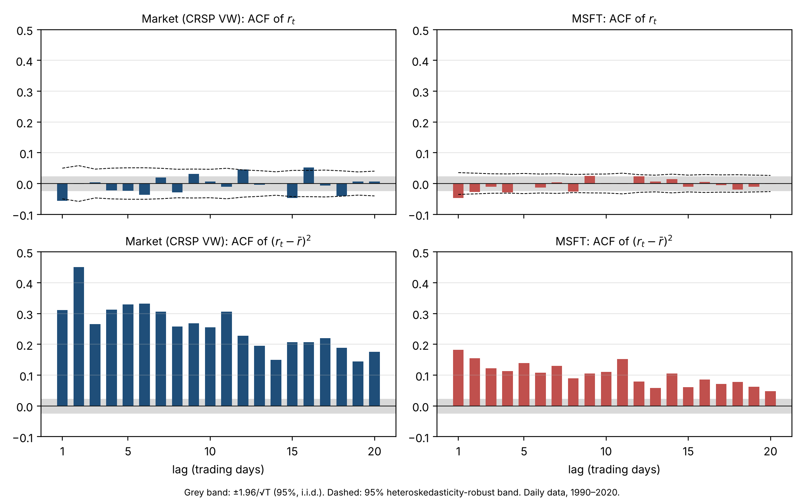
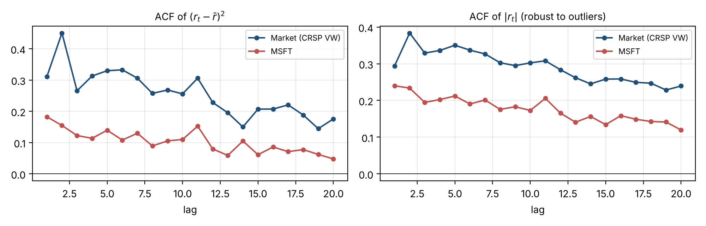
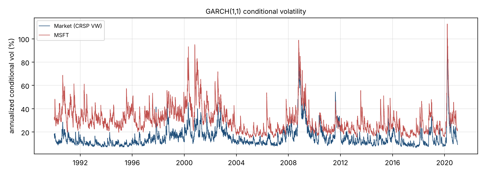
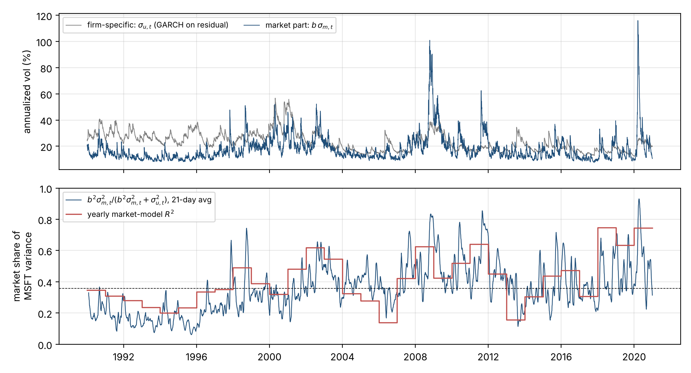
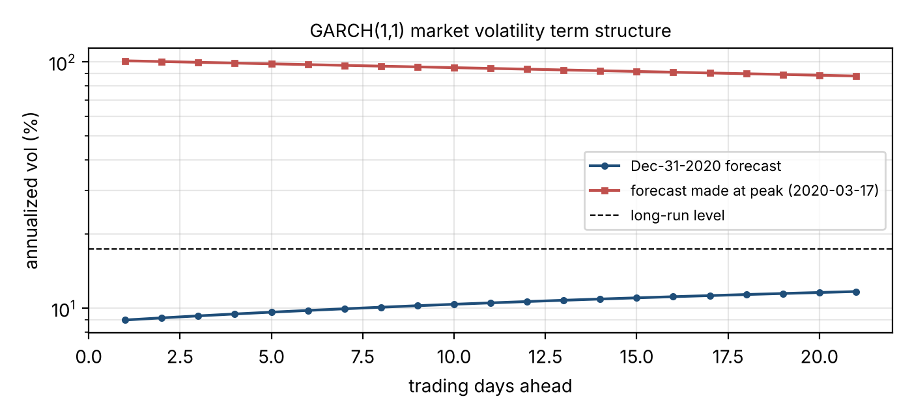
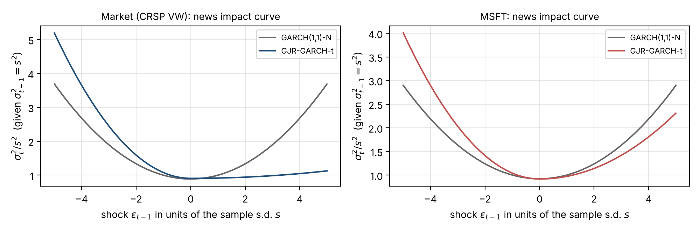

**Data.** CRSP daily data from WRDS, 2 Jan 1990 – 31 Dec 2020 ($T = 7{,}812$ trading days).
The market series is the CRSP value-weighted index return (`vwretd`). The Fama–French `mktrf`
series has a 0.998 correlation with it and gives identical conclusions. MSFT is its CRSP
holding-period return. All returns are in percent per day. Every likelihood below is coded by
hand and maximized numerically (SLSQP, with the stationarity restriction imposed as a
constraint). Standard errors are the robust Bollerslev–Wooldridge sandwich
$\hat H^{-1}\hat S\hat H^{-1}$, built from a numerical Hessian and the outer product of
numerical scores. As an independent check, the `arch` Python package reproduces every point
estimate to the third decimal. Code: `volatility_ps.py`; all numbers: `results.json`.

| | Mean | S.d. | Ann. vol | Skew | Excess kurt. | Min | Max |
|---|---:|---:|---:|---:|---:|---:|---:|
| Market | 0.044 | 1.13 | 17.9% | −0.32 | 11.0 | −11.8 | 11.5 |
| MSFT | 0.102 | 2.02 | 32.1% | 0.23 | 6.5 | −15.6 | 19.6 |

# Question 1

## (a) Autocorrelations of returns and squared returns

**Prior (stated before plotting).** I expect the *market* to show stronger volatility
clustering, meaning higher and more slowly decaying autocorrelations of squared returns. The
reasoning starts from the market model, $r_{i,t} = \beta r_{m,t} + e_{i,t}$. The persistent
part of volatility is economy-wide: recessions, financial crises, monetary-policy uncertainty
and swings in risk appetite keep volatility high for weeks or months, and the market carries
all of it. MSFT carries the same market component plus a firm-specific component $e_{i,t}$,
which is dominated by one-off news such as earnings releases, product launches and antitrust
rulings. That news arrives as a one-day jump and is mostly not followed by more of the same.

Such jumps hurt the measured autocorrelation of squared returns in two ways. They add
variance to $r_{i,t}^2$ that does not persist, which dilutes the persistent signal. And an
isolated spike enters the denominator of the sample autocorrelation as a fourth power, but
the numerator only multiplied by ordinary-sized neighbours, which drags the estimate down.
Diversification removes exactly this noise from the index. For the returns themselves I
expect autocorrelations close to zero for both series, because predictable returns would be
traded away, with perhaps a small negative first-order coefficient from microstructure
effects.

{width=100%}

**Assessment: the prior is correct.** Both series show volatility clustering. The
autocorrelations of squared (demeaned) returns are positive and outside the 95% band at all
20 lags for both, and the Ljung–Box statistics, Q(20) = 11,056 for the market and 1,853 for
MSFT, reject independence overwhelmingly. The clustering is much stronger for the market,
on two measures. On level, the market's squared-return autocorrelations average 0.256 over
lags 1–20, against 0.103 for MSFT, and the market's Q(20) is six times larger. On
persistence, the market's autocorrelation at lag 20 is still 57% of its lag-1 value
(0.176 vs 0.311), while MSFT's has fallen to 26% (0.048 vs 0.182).

The ranking is not driven by a handful of crash days. The autocorrelations of absolute
returns, which are far less sensitive to outliers, show the same pattern (market 0.29 at
lag 1 and 0.24 at lag 20; MSFT 0.24 and 0.12). The data also show the jump mechanism behind
the prior directly. MSFT's largest moves are firm-specific: +19.6% on 19 Oct 2000, −14.5% on
3 Apr 2000 and −15.6% on 24 Apr 2000, while the market moved by less than 4% on each of those
days. Each of these days is a large squared return that is not followed by persistently large
squared returns.

The returns themselves are close to unpredictable, as expected. The largest autocorrelation
is −0.056 (market, lag 1). Against the naive i.i.d. band, 10 of the market's 20 lags and 6 of
MSFT's look significant. That band is too narrow here, though, because the variance is itself
time-varying. Once the band is made robust to heteroskedasticity, only 4 of 20 market lags
and 1 of 20 MSFT lags fall outside it, and every coefficient is below 0.06 in absolute value.
The economically important dependence is in the second moment, not the first.

{width=100%}

## (b) Gaussian GARCH(1,1) by maximum likelihood

**Model.**
$$
r_t = \mu + \varepsilon_t, \qquad \varepsilon_t = \sigma_t z_t, \quad z_t \overset{iid}{\sim} N(0,1), \qquad
\sigma_t^2 = \omega + \alpha\,\varepsilon_{t-1}^2 + \beta\,\sigma_{t-1}^2,
$$
with $\omega>0$, $\alpha,\beta\ge 0$ and $\alpha+\beta<1$ (covariance stationarity).

**Log likelihood.** Conditional on $\mathcal F_{t-1}$, $r_t \sim N(\mu,\sigma_t^2)$, and
$\sigma_t^2$ is a known function of the parameters and past data. By the prediction-error
decomposition, the log likelihood is the sum of the one-step conditional densities. With
$\theta = (\mu,\omega,\alpha,\beta)$:
$$
\mathcal L(\theta) = \sum_{t=1}^{T} \ell_t(\theta) = -\frac{1}{2}\sum_{t=1}^{T}\left[\log(2\pi) + \log\sigma_t^2(\theta) + \frac{(r_t-\mu)^2}{\sigma_t^2(\theta)}\right],
\qquad \hat\theta = \arg\max_{\theta} \mathcal L(\theta),
$$
with the recursion started at $\sigma_1^2 = T^{-1}\sum_t (r_t-\mu)^2$ (backcast).

| | $\mu$ | $\omega$ | $\alpha$ | $\beta$ | $\alpha+\beta$ | Half-life (days) | Long-run ann. vol | log L |
|---|---:|---:|---:|---:|---:|---:|---:|---:|
| Market | 0.071 | 0.0175 | 0.112 | 0.873 | 0.985 | 47 | 17.4% | −10,110.2 |
| | (0.009) | (0.0035) | (0.012) | (0.012) | | | | |
| MSFT | 0.116 | 0.066 | 0.079 | 0.906 | 0.985 | 47 | 33.9% | −15,649.6 |
| | (0.018) | (0.036) | (0.025) | (0.030) | | | | |

*Robust standard errors in parentheses. Half-life $= \log 0.5/\log(\alpha+\beta)$. Long-run
volatility $=\sqrt{252\,\omega/(1-\alpha-\beta)}$.*

Both series have the classic daily-GARCH shape: a small reaction coefficient $\alpha$, a
large memory coefficient $\beta$, and persistence $\alpha+\beta = 0.985$ that is close to
one but clearly below it. Half of any volatility shock has therefore dissipated after about
47 trading days, a little over two months, for both series. Where the two differ is in how
they get there. The market reacts more strongly to a given return surprise
($\alpha = 0.112$ vs 0.079), which is the GARCH counterpart of its higher squared-return
autocorrelations in part (a): the market's surprises are more informative about its future
volatility. MSFT puts more weight on the slowly moving component ($\beta = 0.906$). The
implied long-run volatilities, 17.4% and 33.9%, are close to the sample volatilities of
17.9% and 32.1%, so the model's unconditional level is consistent with the data.

The model also does what it is supposed to do. On the standardized residuals
$\hat z_t = \hat\varepsilon_t/\hat\sigma_t$, the Ljung–Box Q(20) of $\hat z_t^2$ falls to
25.2 ($p = 0.19$) for the market and 11.6 ($p = 0.93$) for MSFT, from 11,056 and 1,853 for
the raw squared returns, so GARCH(1,1) absorbs essentially all of the volatility clustering.
What it does not absorb is the fat tails. The standardized residuals have kurtosis of 4.9
(market) and 8.8 (MSFT), against 3 under normality. The Gaussian likelihood is therefore a
quasi-likelihood. Its estimates remain consistent as long as the mean and variance equations
are right, but the classical standard errors are wrong. That is why the table reports
sandwich standard errors; for MSFT they are two to three times the classical ones (for
$\omega$: 0.036 vs 0.012).

{width=100%}

## (c) "MSFT's volatility is essentially just the market moving"

If the risk manager were right, MSFT's variance would be almost entirely market variance
scaled by its beta, $\sigma^2_{MSFT,t} \approx b^2\sigma^2_{m,t}$. Two things would follow.
The market would explain nearly all of MSFT's return variance, and what is left over, the
firm-specific residual, would be small, with no volatility dynamics of its own. The
estimates contradict both.

Start with how much of MSFT's variance the market explains. In the market model
$r_{MSFT,t} = a + b\,r_{m,t} + u_t$, the estimates are $\hat b = 1.15$ (White s.e. 0.02) and
$R^2 = 0.41$, so the market accounts for 41% of MSFT's daily variance over 1990–2020 and
firm-specific news for the other 59%. The GARCH estimates allow the same split to be made
period by period. Fitting GARCH(1,1) to the market and to the residual $u_t$ gives
$\sigma^2_{MSFT,t} = b^2\sigma^2_{m,t} + \sigma^2_{u,t}$, and the market's share
$b^2\sigma^2_{m,t}/(b^2\sigma^2_{m,t}+\sigma^2_{u,t})$ averages only **0.36**. It exceeds
one half on just 20% of days. Put in volatility terms, the market part of MSFT's volatility
averages 17.8% a year, while the firm-specific part averages 23.5%, so the firm-specific
part is the larger of the two. (As a robustness check, comparing $\hat b_t^2\hat\sigma^2_{m,t}$,
with a rolling one-year beta, to MSFT's own GARCH variance gives a similar average share of
0.41.)

Next, the residual is far from being noise. GARCH(1,1) on $u_t$ gives $\alpha = 0.024$
(0.006) and $\beta = 0.971$ (0.007), with persistence 0.995 and a half-life of about 150
days, and the Ljung–Box Q(20) on $u_t^2$ is 704 ($p<0.001$). Firm-specific volatility
therefore clusters on its own and is even more persistent than market volatility. A risk
model that simply scaled market volatility by beta would miss this component entirely. The
fitted volatility paths make the same point: MSFT's and the market's GARCH volatilities have
a correlation of 0.69, so they are related, but less than half of the variation in one is
shared with the other.

| Period | Market share | Market part vol | Firm-specific vol |
|---|---:|---:|---:|
| Full sample 1990–2020 | 0.36 | 17.8% | 23.5% |
| Dot-com and antitrust 2000–02 | 0.36 | 25.3% | 33.8% |
| Financial crisis Sep 2008–Jun 2009 | 0.64 | 49.4% | 33.7% |
| COVID crash Mar–Apr 2020 | 0.87 | 71.3% | 24.2% |
| Calm year 2017 | 0.32 | 10.0% | 14.7% |

The claim does hold at particular times, and the table shows when. In market-wide crises the
market part of MSFT's volatility explodes while the firm-specific part rises much less, so
the market's share jumps to 0.64 in the financial crisis and 0.87 in the COVID crash. In
those months, MSFT's volatility really was mostly the market moving. Outside crises the
claim fails: in a calm year like 2017 the share is 0.32, and in 2000–02 it stayed near its
average of 0.36 even though MSFT's volatility was very high, because the antitrust case and
the dot-com unwinding raised its firm-specific volatility as much as its market volatility.
Year-by-year regressions show how unstable the relationship is: the $R^2$ ranges from 0.14
(2006) to 0.75 (2018) and the beta from 0.73 to 2.30. The $R^2$ has drifted up over time, to
0.64–0.75 in 2018–2020, as Microsoft became one of the largest weights in the index itself.

**Verdict.** The claim is wrong as a description of MSFT over 1990–2020. On average only
about a third of its variance is market variance, and the firm-specific remainder is large,
persistent and predictable in its own right. The claim is a reasonable approximation only in
market-wide crises and, increasingly, in the most recent years.

{width=100%}

## (d) What the model says about market risk over the next month (as of 31 Dec 2020)

Under GARCH(1,1), the $h$-step variance forecast is
$E_t\sigma^2_{t+h} = \bar\sigma^2 + (\alpha+\beta)^{h-1}(\sigma^2_{t+1}-\bar\sigma^2)$. The
one-month (21-trading-day) variance is the sum of these forecasts.

* **How the model thinks.** The model predicts how large tomorrow's market swings will be
  from two things: how large today's move was, and how turbulent the market has been
  recently. A big move raises the forecast immediately and a run of quiet days lowers it,
  but the forecast is always pulled back toward the long-run average of about 17% a year,
  because neither turbulent nor quiet periods last forever.
* **What it says now.** After a quiet end to 2020, the model puts current market risk at
  about 9% a year, roughly half the normal level. The pull back toward normal is slow (half
  of the gap closes in about two months), so risk is expected to stay low next month,
  rising only to about 12% by the end of January. In return terms, a typical monthly move is
  about 3% up or down, against 5% in an average month, and in 19 of 20 months like this one
  the market would end between about −4.4% and +7.4%.
* **What could go wrong.** Low forecast risk is not the same as no risk. A single large
  shock would raise all of these numbers at once: on 17 March 2020 the same model put
  annualized risk near 100% and a one-month swing of about 27%. The model also assumes
  bell-shaped surprises, while real daily returns have more extreme days than that, so it
  tends to understate the chance of a crash.

{width=80%}

# Question 2 (PhD) — Gaussian GARCH-in-mean

**Model and MLE objective.**
$$
r_t = \mu + \lambda\,g(\sigma_t^2) + \varepsilon_t,\quad \varepsilon_t=\sigma_t z_t,\ z_t\sim N(0,1),\qquad
\sigma_t^2 = \omega+\alpha\varepsilon_{t-1}^2+\beta\sigma_{t-1}^2,
$$
where $g(\sigma^2) = \sigma^2$ (the risk–return trade-off) or $g = \sigma$ or $\log\sigma^2$.
With $\theta = (\mu,\lambda,\omega,\alpha,\beta)$,
$$
\hat\theta = \arg\max_\theta\; \mathcal L(\theta) = -\frac12\sum_{t=1}^T\left[\log 2\pi + \log\sigma_t^2(\theta) + \frac{\big(r_t-\mu-\lambda g(\sigma^2_t(\theta))\big)^2}{\sigma^2_t(\theta)}\right]
$$
subject to $\omega>0$, $\alpha,\beta\ge0$, $\alpha+\beta<1$. The key difference from plain
GARCH is that the residual $\varepsilon_t(\theta) = r_t-\mu-\lambda g(\sigma_t^2)$ now
depends on the variance parameters, so the two recursions must be run jointly: compute
$\sigma_t^2$ from $\varepsilon_{t-1}$, then $\varepsilon_t$ from $\sigma_t^2$. For the same
reason the information matrix is no longer block-diagonal between the mean and variance
parameters. A misspecified variance equation now makes the mean estimates inconsistent too,
so the two parts must be estimated jointly rather than in two steps.

*Illustration (not required).* With $g=\sigma^2$, the market gives
$\hat\lambda = 0.041$ (robust s.e. 0.013) and MSFT gives $\hat\lambda = 0.012$ (s.e. 0.009).
The market shows a significant positive risk–return trade-off and MSFT does not, which is
what theory predicts if only systematic risk is priced.

**Adding return predictors $X_t$ to the mean.** Replace the mean with
$m_t(\theta) = \mu + \lambda g(\sigma_t^2) + \gamma' X_{t-1}$, where $X_{t-1}$ is known at
$t-1$ (dividend yield, term spread, lagged returns, ...), and maximize
$$
\mathcal L(\theta,\gamma) = -\tfrac12\sum_t\left[\log2\pi+\log\sigma_t^2+\frac{(r_t-m_t)^2}{\sigma_t^2}\right],\qquad \varepsilon_t = r_t - m_t.
$$
Only two things change: the extra parameters $\gamma$ enter the residual $\varepsilon_t$, and
the variance recursion is fed this new residual. The predictors must be known before the
return they predict, and they must not be collinear with $g(\sigma^2_t)$. If one of them is
itself a volatility proxy, $\lambda$ and $\gamma$ compete for the same variation and become
weakly identified.

**Adding variance predictors $Q_t$ to the GARCH equation (GARCH-X).**
$$
\sigma_t^2 = \omega + \alpha\varepsilon_{t-1}^2 + \beta\sigma_{t-1}^2 + \delta' Q_{t-1}
$$
Examples are lagged VIX², realized variance, or market variance as in Q1(c). The objective is
unchanged, but the model needs four additional regularity conditions, because the
restrictions that made plain GARCH well behaved no longer cover the new term.

The first is positivity. In plain GARCH, $\omega>0$ and $\alpha,\beta\ge0$ guarantee
$\sigma^2_t>0$, but $\delta'Q_{t-1}$ can be negative and push the variance below zero, at
which point the likelihood is undefined. Positivity is guaranteed if the predictors are
non-negative (variances, squared spreads) and $\delta\ge0$. For predictors that can take
either sign, one must either restrict $\omega + \delta'Q_t > 0$ over the whole support of
$Q$, or reparameterize so positivity holds automatically, for example with $(\delta'Q)^2$,
$\exp(\delta'Q)$, or an EGARCH-X model for $\log\sigma^2_t$.

The second is measurability. $Q_{t-1}$ must be known at $t-1$. Otherwise $\sigma^2_t$ is not
a conditional variance, the prediction-error decomposition behind the likelihood breaks
down, and the model is no longer a forecasting model.

The third is stationarity and finite moments. With an exogenous input, $\alpha+\beta<1$ is
no longer sufficient. The variance inherits the behaviour of $Q$, so $Q_t$ must itself be
strictly stationary and ergodic with $E|Q_t|<\infty$, and with $E\|Q_t\|^2<\infty$ for
asymptotic normality of the MLE. Then
$E\sigma^2 = (\omega+\delta'E[Q])/(1-\alpha-\beta)$ exists. A trending or unit-root
predictor would make $\sigma^2_t$ non-stationary even with $\alpha+\beta<1$.

The fourth is identification. $\omega$ and $\delta'E[Q]$ can be told apart only if $Q$
actually varies over time, and $Q$ must not be (even asymptotically) collinear with
$\varepsilon^2_{t-1}$ or $\sigma^2_{t-1}$. When $Q$ is a strong volatility proxy, $\alpha$
is often pushed to the boundary $\alpha = 0$. Standard asymptotics then fail, and a
likelihood-ratio test of $\delta=0$ follows a mixture of $\chi^2$ distributions rather than
a $\chi^2$.

# Question 3 (PhD) — GJR-GARCH(1,1,1) with Student-$t$ innovations

**Model.**
$$
r_t = \mu+\varepsilon_t,\quad \varepsilon_t=\sigma_t z_t,\quad z_t \overset{iid}{\sim} t_\nu^{std}\ (\text{mean }0,\ \text{variance }1,\ \nu>2),
$$
$$
\sigma_t^2 = \omega + \big(\alpha + \gamma\,\mathbb 1\{\varepsilon_{t-1}<0\}\big)\varepsilon_{t-1}^2 + \beta\sigma^2_{t-1}.
$$
The log-likelihood with the standardized-$t$ density is
$$
\mathcal L = \sum_t\left[\log\Gamma\!\left(\tfrac{\nu+1}{2}\right)-\log\Gamma\!\left(\tfrac{\nu}{2}\right)-\tfrac12\log\big(\pi(\nu-2)\big)-\tfrac12\log\sigma_t^2-\tfrac{\nu+1}{2}\log\!\left(1+\frac{\varepsilon_t^2}{(\nu-2)\sigma_t^2}\right)\right].
$$

**Non-integration (covariance-stationarity) condition.** Write
$\varepsilon_{t-1}^2 = \sigma^2_{t-1}z_{t-1}^2$ and
$\mathbb 1\{\varepsilon_{t-1}<0\} = \mathbb 1\{z_{t-1}<0\}$ (since $\sigma_{t-1}>0$). Then
$$
\sigma_t^2 = \omega + \sigma^2_{t-1}\,\big[\alpha z_{t-1}^2 + \gamma z_{t-1}^2\mathbb 1\{z_{t-1}<0\} + \beta\big].
$$
Because $z_{t-1}$ is independent of $\sigma^2_{t-1}\in\mathcal F_{t-2}$,
$$
E_{t-2}\,\sigma_t^2 = \omega + \big(\alpha\,E z^2 + \gamma\,E[z^2\mathbb 1\{z<0\}] + \beta\big)\sigma_{t-1}^2 = \omega + \phi\,\sigma^2_{t-1}.
$$
Here $E z^2 = 1$. Because the standardized $t$ is symmetric about zero,
$E[z^2\mathbb 1\{z<0\}] = \tfrac12 E z^2 = \tfrac12$, for any $\nu>2$. Hence
$$
\phi = \alpha + \tfrac{\gamma}{2} + \beta.
$$
Iterating, $E_{t-k}\sigma^2_{t} = \omega\sum_{j=0}^{k-2}\phi^j + \phi^{k-1}\sigma^2_{t-k+1}$.
Shocks to variance die out, and the unconditional variance
$E\sigma_t^2 = E\varepsilon^2_t = \omega/(1-\phi)$ is finite and positive, if and only if
$$
\boxed{\ \alpha + \tfrac12\gamma + \beta < 1\ }\qquad(\text{with } \omega>0,\ \alpha\ge0,\ \alpha+\gamma\ge0,\ \beta\ge0,\ \nu>2).
$$
At $\phi=1$ the model is *integrated* (IGARCH-type): variance shocks are permanent, and the
unconditional variance does not exist. Strict stationarity needs only the weaker condition
$E\log(\alpha z^2+\gamma z^2\mathbb 1\{z<0\}+\beta)<0$; the condition above is the one for a
finite unconditional variance and mean-reverting forecasts. With asymmetric innovations,
$\tfrac12$ would be replaced by $E[z^2\mathbb 1\{z<0\}]$. The forecast half-life is
$\log 0.5/\log\phi$.

**Estimates** (robust s.e. in parentheses; $\phi = \alpha+\gamma/2+\beta$):

| | $\mu$ | $\omega$ | $\alpha$ | $\gamma$ | $\beta$ | $\nu$ | $\phi$ | log L |
|---|---:|---:|---:|---:|---:|---:|---:|---:|
| Market | 0.065 | 0.0137 | 0.009 | 0.163 | 0.895 | 6.9 | 0.985 | −9,832.4 |
| | (0.008) | (0.0024) | (0.006) | (0.018) | (0.010) | (0.57) | | |
| MSFT | 0.073 | 0.032 | 0.056 | 0.068 | 0.910 | 5.3 | 1.000† | −15,220.2 |
| | (0.016) | (0.010) | (0.010) | (0.015) | (0.014) | (0.32) | | |

† The constraint $\phi<1$ binds. Without it the MLE is $\phi = 1.0017$, with a
log-likelihood gain of only 0.12, so the data cannot distinguish MSFT's GJR-$t$ variance from
an integrated process.

Log-likelihood ladder (which feature matters):

| | GARCH-N | GARCH-$t$ | GJR-N | GJR-$t$ |
|---|---:|---:|---:|---:|
| Market | −10,110.2 | −9,927.5 | −9,999.7 | −9,832.4 |
| MSFT | −15,649.6 | −15,238.1 | −15,624.0 | −15,220.2 |

**GJR-$t$ compared with GARCH(1,1)-N.** The richer model fits far better. Adding two
parameters raises the log likelihood by 278 for the market and 429 for MSFT, which is
enormous by any likelihood-ratio standard. The ladder shows where the gain comes from, and
the answer differs between the series. For MSFT almost all of it comes from fat tails
(+412 from switching to $t$ innovations, against +25 from the leverage term), whereas for the
market both features matter (+183 from fat tails, +111 from leverage). The estimated degrees
of freedom confirm the fat tails: $\hat\nu = 6.9$ for the market and 5.3 for MSFT. Even after
GARCH scaling, the standardized shocks are far from Gaussian, and more so for the single
stock, whose firm-specific jumps are exactly what part (a) pointed to. This is also why the
Gaussian GARCH of Q1 has to be read as a quasi-MLE.

The dynamics change in an instructive way. In GARCH-N, all news enters through one symmetric
coefficient $\alpha$. In GJR, the market's symmetric coefficient collapses to
$\alpha = 0.009$, which is not significant, while the negative-news coefficient is
$\gamma = 0.163$. Essentially *all* of the market's ARCH effect therefore comes from negative
returns; GARCH-N had been averaging a strong reaction to bad news with almost no reaction to
good news. The market's persistence is unchanged at $\phi = 0.985$ (half-life about 46
days), but its implied long-run volatility falls from 17.4% to 15.2%. The asymmetric model
attributes high-variance periods to runs of negative shocks rather than to a higher
baseline. For MSFT the persistence rises to the unit-root boundary, because both the
average news response $\alpha+\gamma/2$ (0.079 → 0.090) and $\beta$ (0.906 → 0.910) go up.
Under a fat-tailed density, MSFT's largest outliers are down-weighted as ordinary $t$-draws
instead of forcing a lower $\beta$, which leaves a smoother and more persistent variance
path. As a result, MSFT's long-run variance is poorly pinned down by this model.

**Leverage: market vs MSFT.**

| | $\alpha$ (good news) | $\alpha+\gamma$ (bad news) | Ratio bad/good |
|---|---:|---:|---:|
| Market | 0.009 | 0.171 | ≈ 19 |
| MSFT | 0.056 | 0.124 | ≈ 2.2 |

The asymmetry is far stronger for the market. Its $\gamma = 0.163$ is 2.4 times MSFT's 0.068.
For the index, good news barely raises volatility at all, while for MSFT both signs matter.
This is the standard finding, and it argues against a pure *financial leverage* explanation.
Microsoft had essentially no debt over this period, yet its volatility asymmetry is mild,
while the index's is extreme. The asymmetry instead looks systematic. Under **volatility
feedback**, a rise in market risk raises required returns and lowers prices, so negative
returns and rising volatility arrive together; correlations also spike in selloffs. Both
effects act on the aggregate. Firm-specific shocks, by contrast, raise MSFT's volatility
whether they are good or bad: the October 2000 earnings surprise (+19.6%) was as much a
volatility event as the April 2000 antitrust losses. Consistent with Q1(c), MSFT's $\gamma$
is 0.42 times the market's, close to the 0.36–0.41 share of its variance that comes from the
market, so MSFT's leverage effect is about what its market component alone would deliver.

{width=100%}
